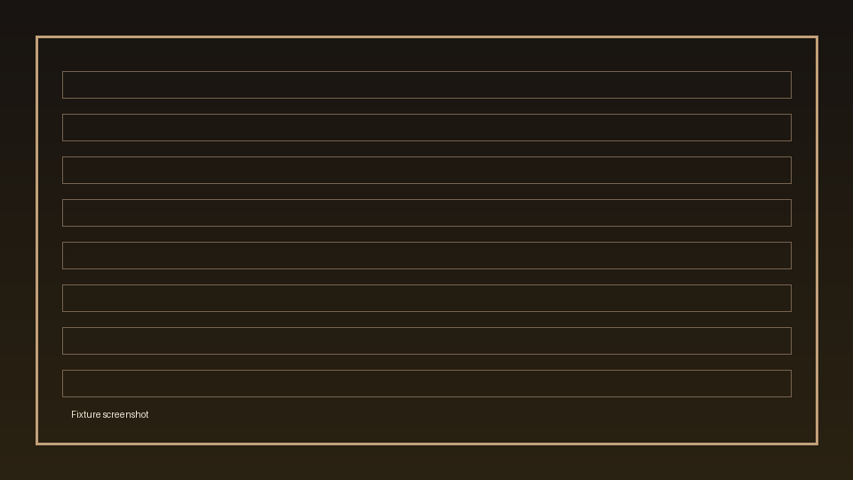

> This is a sample page for testing the website's docs build. It is not real documentation.

The import reads the `.dmp` file straight from the device.

## Before you start

> [!WARNING]
> Check the device's compass calibration date before trusting a survey.

## Choosing sections

Tick the sections to import. Sections already in the project are flagged.

## Placing sections

The first section is anchored by its [zero datum](#choosing-sections); each
later one is placed against what is already there.

### The “Suggest” step

Stalagmight suggests a join from matching [stations](../concepts/stations-and-shots.md#stations).

### The “Suggest” step

A second heading with the same text, for the GitHub-style `-1` anchor.

Already have Ariane data? See [Ariane files](ariane.md). The file format is
specified in the [developer spec](../../SPEC.md).
